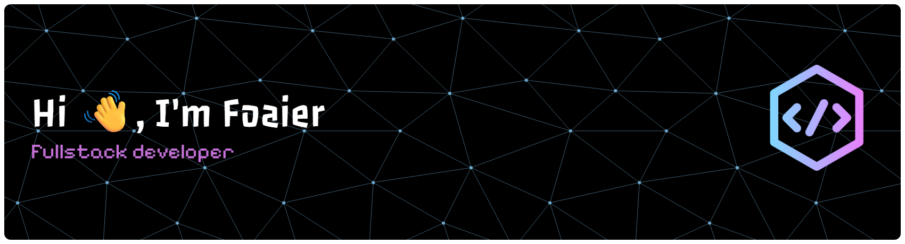

<!--
**foaier/foaier** is a ✨ _special_ ✨ repository because its `README.md` (this file) appears on your GitHub profile.

Here are some ideas to get you started:

- 🔭 I'm currently working on ...
- 🌱 I'm currently learning ...
- 👯 I'm looking to collaborate on ...
- 🤔 I'm looking for help with ...
- 💬 Ask me about ...
- 📫 How to reach me: ...
- 😄 Pronouns: ...
- ⚡ Fun fact: ...
-->

---

[**English**](#about-me) | [简体中文](#关于我)

## 👨‍💻 About Me

I'm a **Full-stack** with over **10 years of experience** in C# and .NET development. I specialize in building robust, scalable applications across the full technology stack - from client-side applications to enterprise-grade backend services.

### 🎯 What I Do

- **Full-Stack .NET Development** - Building end-to-end solutions using the Microsoft technology stack
- **Legacy System Modernization** - Transforming and upgrading legacy applications to modern architectures
- **Microservices Architecture** - Designing and implementing distributed systems with Kubernetes
- **Modern UI Development** - Creating beautiful, responsive applications with WinUI 3
- **Cloud-Native Solutions** - Deploying and managing applications in containerized environments

### 🛠️ Core Technologies

### 🔧 Technical Expertise

- **Backend Development**: ASP.NET Core, Web APIs, Entity Framework, SignalR
- **Frontend Development**: WinUI 3, XAML, MVVM Pattern, Modern Windows Apps
- **DevOps & Cloud**: Kubernetes, Docker, Azure DevOps, CI/CD Pipelines
- **Database**: SQL Server, Entity Framework Core, Database Design
- **Architecture**: Microservices, REST APIs, Event-Driven Architecture
- **Legacy Modernization**: .NET Framework to .NET Core/.NET 6+, Monolith to Microservices, Database Migration, Legacy System Migration
- **Testing**: Unit Testing, Integration Testing, Test-Driven Development

### 🌱 Currently Learning

- **Cloud-Native Patterns** - Exploring advanced microservices patterns
- **Modern UI Frameworks** - Staying updated with the latest WinUI 3 features
- **Performance Optimization** - Deep diving into .NET performance tuning

### 💬 Ask Me About

- C# best practices and advanced language features
- .NET Core/Framework development strategies
- Legacy system modernization and migration strategies
- Microservices architecture and Kubernetes deployment
- WinUI 3 application development and modern Windows apps
- Database design and Entity Framework optimization
- Software architecture and design patterns

### 📫 How to Reach Me

### ⚡ Fun Fact

When I'm not coding, you'll find me exploring new technologies, contributing to open-source projects, or sharing knowledge with the developer community. I believe in continuous learning and helping others grow in their software development journey.

---

**Let's build something amazing together! 🚀**

---

[English](#about-me) | [**简体中文**](#关于我)

## 👨‍💻 关于我

我是一名**全栈开发者**，在 C# 和 .NET 开发方面拥有超过 **10 年经验**。我专注于构建稳健、可扩展的应用，覆盖完整技术栈，从客户端应用到企业级后端服务。

### 🎯 我所从事的工作

- **全栈 .NET 开发** - 使用 Microsoft 技术栈构建端到端解决方案
- **遗留系统现代化** - 将遗留应用改造并升级为现代化架构
- **微服务架构** - 使用 Kubernetes 设计并实现分布式系统
- **现代 UI 开发** - 使用 WinUI 3 创建美观且能适配不同屏幕的应用
- **云原生解决方案** - 在容器化环境中部署和管理应用

### 🛠️ 核心技术

### 🔧 技术专长

- **后端开发**：ASP.NET Core、Web API、Entity Framework、SignalR
- **前端开发**：WinUI 3、XAML、MVVM 模式、现代 Windows 应用
- **DevOps 与云**：Kubernetes、Docker、Azure DevOps、CI/CD 流水线
- **数据库**：SQL Server、Entity Framework Core、数据库设计
- **架构**：微服务、REST API、事件驱动架构
- **遗留系统现代化**：从 .NET Framework 迁移至 .NET Core/.NET 6+、从单体架构迁移至微服务、数据库迁移、遗留系统迁移
- **测试**：单元测试、集成测试、测试驱动开发

### 🌱 正在学习

- **云原生模式** - 探索进阶的微服务模式
- **现代 UI 框架** - 持续关注 WinUI 3 的最新功能
- **性能优化** - 深入学习 .NET 性能调优

### 💬 欢迎交流

- C# 最佳实践与高级语言特性
- .NET Core/.NET Framework 开发策略
- 遗留系统现代化与迁移策略
- 微服务架构与 Kubernetes 部署
- WinUI 3 应用开发与现代 Windows 应用
- 数据库设计与 Entity Framework 优化
- 软件架构与设计模式

### 📫 联系方式

### ⚡ 编程之外

不写代码时，你可能会发现我在探索新技术、参与开源项目，或与开发者社区分享知识。我相信持续学习，也乐于帮助他人在软件开发道路上成长。

---

[English](#about-me) | [简体中文](#关于我)

